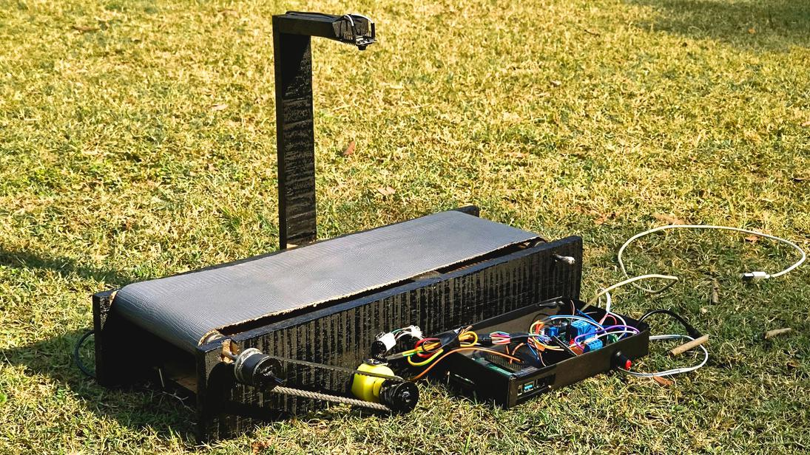
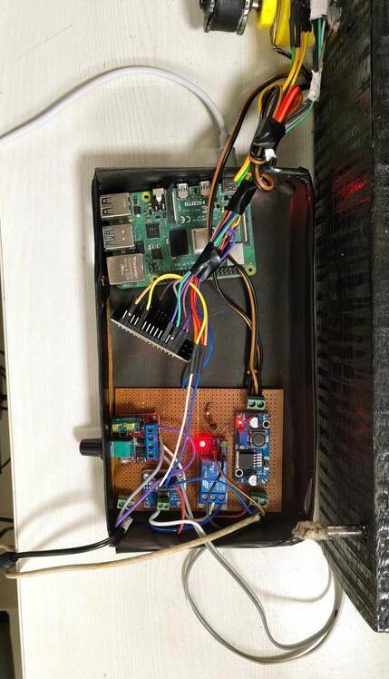
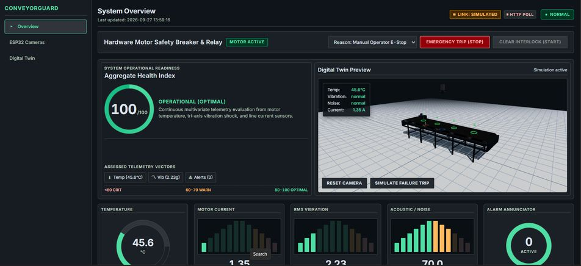
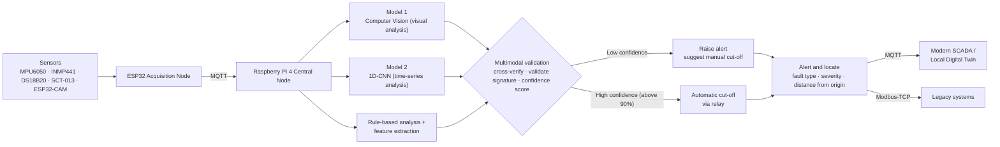

<div align="center">

# 🛡️ ConveyorGuard

### Intelligent Monitoring & Prediction of Conveyor Belt Joint Rupture and Damages in the Iron Ore Mining Industry

**An edge-autonomous IIoT safety platform with multi-modal sensing, TinyML fault verification, autonomous fail-safe cut-off and a real-time 3D Digital Twin SCADA dashboard.**


### 🔗 Quick Links

[](https://youtu.be/VCM-2Ph6djU)
[](https://conveyorguard.onrender.com/)


</div>

---

## 📑 Table of Contents

1. [Problem Statement](#-problem-statement)
2. [Our Solution](#-our-solution)
3. [Demo & Prototype](#-demo--prototype)
4. [System Architecture](#-system-architecture)
5. [Fault Detection Pipeline](#-fault-detection-pipeline)
6. [Key Features](#-key-features)
7. [Failure Modes Covered](#-failure-modes-covered)
8. [Technology Stack](#-technology-stack)
9. [Hardware & Bill of Materials](#-hardware--bill-of-materials)
10. [SCADA Dashboard & Digital Twin](#-scada-dashboard--digital-twin)
11. [Project Structure](#-project-structure)
12. [MQTT & API Interface Specification](#-mqtt--api-interface-specification)
13. [Getting Started](#-getting-started)
14. [Testing MQTT Telemetry](#-testing-mqtt-telemetry-via-terminal)
15. [Feasibility & Economic Viability](#-feasibility--economic-viability)
16. [Risks & Mitigation](#-risks--mitigation)
17. [Impact & Benefits](#-impact--benefits)
18. [Initial Results](#-initial-results)
19. [References](#-references)
20. [Team](#-team)
21. [License](#-license)

---

## 🎯 Problem Statement

| | |
|---|---|
| **Problem Statement ID** | SIH26008 |
| **Title** | Belt Joint Rupture and Conveyor Belt Damages in Iron Ore Mining Industry: Intelligent Monitoring and Prediction of Conveyor Belt Joint Rupture and Damages in Iron Ore Mining Industry |
| **Theme** | Smart Automation |
| **Category** | Hardware |

Conveyor belts are the backbone of iron ore handling. A belt joint rupture or a longitudinal tear halts production, spills ore and puts maintenance crews at risk. Today's approaches leave serious gaps:

| Existing Method | Gap | How ConveyorGuard Fixes It |
|---|---|---|
| **Conductive / inductive rip-detection loops** | Signal only *after* the belt rips; no early warning; up to 24 hr loop-repair downtime | Continuous sensing with a graded AI confidence score, flagging degradation *before* rupture |
| **Magnetic Flux Leakage (MFL) & X-ray imaging** | Periodic only (a few times a year); high cost; limited coverage | Low per-node cost enables dense zone coverage; complements periodic MFL / X-ray |
| **Standalone vision systems** | Surface-only; isolated from plant SCADA | Vision **+** vibration, acoustic, thermal and current sensing per node, bridged to existing SCADA / PLC |

---

## 💡 Our Solution

**ConveyorGuard** is an end-to-end, edge-autonomous IIoT safety platform for industrial conveyors. It combines **multi-modal sensing** and **edge AI** with a local **SCADA digital twin** to deliver **sub-second fault detection**, **automated fail-safe cut-offs** and **100% offline resilience**.

- **Target domain:** Continuous belt-joint and surface-fault prevention for heavy iron ore handling.
- **System topology:** A decentralised cluster of **1–4 zonal ESP32 nodes** connected to a local **Raspberry Pi 4 edge hub**.
- **Primary objective:** Replace high-CAPEX legacy suites with a **low-cost, offline-first predictive-maintenance** solution.

### How it addresses the problem

| Challenge | ConveyorGuard's Answer |
|---|---|
| **Detection latency** | Sub-second edge processing enables instant safety cut-offs. |
| **Connectivity outages** | Offline-first **store-and-forward** architecture (edge-buffered SQLite) keeps data loss near zero and auto-syncs when connectivity returns. |
| **Human delay & false trips** | Multi-sensor AI fusion validates anomalies and automates shutdown only at high confidence. |
| **Hazardous manual patrols** | Optical defect localisation logs the exact defect position, reducing high-risk manual belt inspections. |

### What makes it unique

1. **Zero cloud / internet dependency (edge autonomy)** – fully offline fault detection with edge-buffered SQLite logging; auto-syncs with cloud servers once connectivity restores.
2. **Multi-modal sensor fusion + edge vision** – 5-point physical telemetry (vibration, acoustics, thermal, current) combined with edge vision to inspect and classify belt faults.
3. **Auto safety cut-off (zero human delay)** – automated emergency power cut-off triggered at **>90% AI confidence** to prevent catastrophic failure.
4. **Industrial protocol & SCADA interoperability** – integrates into existing plant architectures through standard **MQTT, Modbus and OPC UA**, with real-time dashboard parameter tuning.
5. **Built for harsh industrial environments** – modular, field-replaceable sensor architecture, scalable from a prototyping bench to heavy real-world conveyor systems.

---

## 🎬 Demo & Prototype

| Resource | Link |
|---|---|
| 🎥 **Hardware prototype video (YouTube)** | [Watch the demo video](https://youtu.be/VCM-2Ph6djU) |
| 🖥️ **Live dashboard demo** | [Open the dashboard demo](https://conveyorguard.onrender.com/) |

<div align="center">

| Physical Prototype | Controller & Sensor Suite |
|:---:|:---:|
|  |  |

| Edge SCADA Dashboard with 3D Digital Twin |
|:---:|
|  |

</div>

**Prototype sensor placement**

| Sensor / Module | Placement | Role |
|---|---|---|
| **ESP32-CAM** | Mounted on an overhead arm above the belt | Visual anomaly / surface-tear detection |
| **INMP441** (I²S microphone) | Near the drive | Acoustic data, squeal and impact detection |
| **MPU6050 + DS18B20** | On the motor / drive assembly | 3-axis vibration and thermal stress |
| **SCT-013** | On the motor supply line | Current spikes of the motor |
| **ESP32** (sensor node) | Controller enclosure | Local sensor acquisition |
| **Raspberry Pi 4** (central hub) | Controller enclosure | Edge AI inference, MQTT broker, dashboard host |
| **Relay module** (control unit) | Controller enclosure | Motor contactor / emergency cut-off |

---

## 📐 System Architecture

```text
┌──────────────────────────────────────────────────────────────┐
│              RASPBERRY PI 4 — CENTRAL EDGE HUB               │
│                 Wi-Fi Hotspot IP: 10.42.0.1                  │
│                                                              │
│  ┌────────────────────┐        ┌───────────────────────────┐ │
│  │ Mosquitto Broker   │◄──────►│ Node.js Server            │ │
│  │ Port 1883          │        │ Express + WebSocket :3001 │ │
│  └────────────────────┘        └───────────────────────────┘ │
│ TinyML inference (TFLite) · SQLite store-and-forward buffer  │
└───────┬────────────────┬───────────────────────┬─────────────┘
        ▲                ▲                       ▲
        │ MQTT           │ MQTT                  │ HTTP / WS
┌───────┴──────┐ ┌───────┴──────┐  ┌─────────────┴─────────────┐
│ ESP32 Sensor │ │ ESP32-CAM    │  │ Operator Browser          │
│ Node (×1–4)  │ │ Node(s)      │  │ • 3D Digital Twin         │
│ • DS18B20    │ │ • Belt view  │  │ • Live metrics            │
│ • MPU6050    │ │ • Splice cam │  │ • E-Stop controls         │
│ • INMP441    │ │ MJPEG :81    │  └───────────────────────────┘
│ • SCT-013    │ └──────────────┘
│ • Relay      │
└──────────────┘
```

### Multi-node deployment

One Raspberry Pi hub serves **up to 4 zonal ESP32 sensor nodes**. Each zone carries a full sensor suite, so mines can expand coverage incrementally instead of re-architecting per belt.

```text
                     ┌───────────────────────────┐
                     │   Existing Plant SCADA    │
                     └─────────────▲─────────────┘
                                   │  MQTT / Modbus-TCP (Ethernet)
                     ┌─────────────┴─────────────┐
                     │ Raspberry Pi 4 (Central   │
                     │ Node) + Local Digital Twin│
                     └──┬──────┬───────┬──────┬──┘
                        │      │       │      │   Wi-Fi / MQTT
                    ┌───┴──┐┌──┴───┐┌──┴───┐┌─┴────┐
                    │ESP32 ││ESP32 ││ESP32 ││ESP32 │
                    │Zone 1││Zone 2││Zone 3││Zone 4│
                    └──────┘└──────┘└──────┘└──────┘
                      each with a full sensor suite
```

### Two-tier node design

| Tier | Hardware | Responsibility |
|---|---|---|
| **Acquisition node** | ESP32 | Acts as the local node: gathers readings from all sensors and drives the cut-off relay. |
| **Central / inference node** | Raspberry Pi 4 | Data processing, TinyML inference, multimodal validation, MQTT broker, dashboard hosting, SQLite store-and-forward. |

Separating acquisition from inference spreads thermal and processing load, avoids decision-speed bottlenecks and reduces single-chip strain.

---

## 🧠 Fault Detection Pipeline



| Stage | What happens |
|---|---|
| **1. Detection** | Sensors sense anomalies in real time: vibration (MPU6050), acoustics (INMP441), thermal stress (DS18B20), motor current spikes (SCT-013) and visual defects (ESP32-CAM). |
| **2. Acquisition** | The ESP32 node gathers all sensor readings and publishes them over MQTT. |
| **3. Inference** | The Pi runs **Model 1** (computer-vision visual analysis on camera frames) and **Model 2** (1D-CNN time-series analysis on vibration data) alongside rule-based analysis and feature extraction, all via TensorFlow Lite. |
| **4. Multimodal validation** | Check all sensors → cross-verify across readings → validate the fault signature → compute a confidence score. This confirms whether the alarm is genuine and prevents false trips. |
| **5. Action** | **Low confidence** (e.g. 68/100): inspection flagged, *suggest manual cut-off*. **High confidence (>90%)** (e.g. 94/100): *critical fault, automatic cut-off*. |
| **6. Alert & locate** | Fault type (e.g. splice tear), severity and distance from belt origin (metres) are logged and explained on the digital twin. |
| **7. Distribution** | Results go to modern SCADA over MQTT and to legacy systems over Modbus-TCP (Ethernet). If no fault is detected, the latest readings are simply updated. |

---

## ✨ Key Features

- **📡 Multi-modal sensing** – continuous real-time monitoring via motor current, 3-axis vibration, I²S acoustics, thermal data and ESP32-CAM visual inspection.
- **🤖 Smart AI fault verification** – cross-sensor fusion validates anomalies and generates AI confidence scores so that safety cut-offs are not triggered by false alarms.
- **⚡ Autonomous auto-cut-off & emergency stop** – hardware relay controlled autonomously (>90% confidence) or manually from the dashboard / MQTT, with an operator reset workflow to verify clearance before re-energising the circuit.
- **📍 Precise defect mapping** – the ESP32-CAM detects surface wear or tears and logs the exact defect position for instant, targeted repair, reducing the frequency of manual belt inspections.
- **🎮 Interactive 3D digital twin (Three.js)** – animated conveyor reflecting live drive status, roller rotation and belt speed; splice-joint inspection tracking wear, temperature, vibration, splice gap and tension; automatic emergency halt when the relay trips or a failure is simulated.
- **📷 Multi-camera ESP32-CAM grid** – live MJPEG streams from multiple camera nodes covering the belt drive, discharge chute and splice joints.
- **🔌 Offline-first operation** – SQLite store-and-forward logging; the system keeps detecting and cutting off with no internet and syncs to the cloud when it returns.
- **🏭 Industrial interoperability** – standard **MQTT**, **Modbus** and **OPC UA** protocols with real-time dashboard parameter tuning; no PLC replacement required.
- **🧱 Modular & field-replaceable** – each sensor module can be swapped for an industry-grade equivalent without redesigning the system.
- **🌓 Dark / Light industrial SCADA theme** – high-contrast design aligned with industrial monitoring guidelines.
- **🔁 Graceful fallback** – seamless fallback to high-fidelity simulated telemetry when hardware is offline (great for demos and development).

---

## 🔍 Failure Modes Covered

| Industrial Failure Mode | Target Anomaly | Sensing Technique |
|---|---|---|
| **Belt misalignment & drift** | Lateral tracking error | ESP32-CAM vision + 3-axis vibration |
| **Material overload / jam** | Current spikes & high friction | Motor current + shock accelerometer + acoustic |
| **Splice, tear & surface wear** | Physical edge & surface damage | Optical edge-AI inspection |
| **Motor & bearing failure** | Thermal rise & abnormal squeal | 1-Wire thermal + I²S acoustic microphone |

> **Note:** Some sensors are used for prototyping only. A production deployment requires industry-compatible sensors, which can be integrated easily thanks to the modular architecture.

---

## 🧰 Technology Stack

| Category | Technology / Tool | Purpose |
|---|---|---|
| **Microcontrollers** | Raspberry Pi 4 | Edge processing, communication, broker & dashboard host |
| | ESP32 / ESP32-CAM | Local sensor acquisition, relay control, MJPEG video |
| **Sensor suite** | DS18B20, INMP441, SCT-013, MPU6050, ESP32-CAM | Multimodal sensing: temperature, acoustic, current, vibration and visual |
| **TinyML** | TensorFlow Lite | On-device anomaly detection and fault classification (CV model + 1D-CNN) |
| **Messaging** | Mosquitto MQTT, Modbus-TCP, OPC UA | Device telemetry and SCADA / PLC interoperability |
| **Storage** | SQLite | Edge-buffered store-and-forward logging |
| **Backend** | Node.js, Express, WebSocket | REST API, MQTT bridge and live data broadcast |
| **Frontend** | React, Vite, Three.js, HTML5, CSS3 | SCADA dashboard and 3D digital twin |

---

## 🔌 Hardware & Bill of Materials

### Per-node hardware

| Component | Connected To | Description |
|---|---|---|
| **Raspberry Pi 3/4/5** (prototype: Pi 4) | Hotspot gateway | Runs Mosquitto MQTT (`1883`), Node.js dashboard (`3001`) and the TinyML inference pipeline |
| **ESP32 Dev Module** | Wi-Fi hotspot | Collects sensor data, controls the relay, publishes to MQTT |
| **Relay module** | ESP32 GPIO 26 | Motor circuit contactor / emergency cut-off |
| **DS18B20** temperature sensor | ESP32 GPIO 4 | 1-Wire thermal monitoring of motor & bearings |
| **SCT-013** current sensor | ESP32 GPIO 34 (analog) | Motor current / current-spike monitoring |
| **MPU6050** accelerometer | ESP32 (I²C) | 3-axis vibration & shock |
| **INMP441** microphone | ESP32 (I²S) | Acoustic spike / SPL detection |
| **ESP32-CAM module(s)** | Wi-Fi hotspot | Streams MJPEG video on port 81 (`/stream`) |

> 📝 GPIO assignments reflect the current firmware under `esp32/sensor_relay_mqtt/`. Check the sketch for the exact I²C / I²S pin mapping before wiring.

### Cost breakdown (MRP)

| Sensor | MRP | Controller | MRP |
|---|---:|---|---:|
| MPU6050 | ₹230 | ESP32 | ₹390 |
| INMP441 | ₹190 | ESP32-CAM (×2) | ₹1,200 |
| DS18B20 | ₹120 | Raspberry Pi 4 (₹6,500 shared across 4 nodes) | ₹1,625 |
| SCT-013 | ₹249 | | |
| Relay | ₹300 | | |
| **Sensors subtotal** | **₹1,089** | **Controllers subtotal** | **₹3,215** |

**Integrated node cost = ₹1,089 + ₹3,215 = ₹4,304** &nbsp;→&nbsp; **1 hub + 4 zonal nodes = ₹17,216 per monitoring zone.**

---

## 🖥️ SCADA Dashboard & Digital Twin

The edge-hosted dashboard is served directly from the Raspberry Pi and is reachable from any laptop, tablet or phone on the hotspot.

- **System overview** with an *Aggregate Health Index* (0–100; `<60` critical, `60–79` warn, `80–100` optimal) and assessed telemetry vectors.
- **Live gauges & trends:** temperature, motor current, RMS vibration, acoustic / noise, and an alarm annunciator.
- **3D Digital Twin preview:** animated belt with live temp / vibration / noise / current overlays, *Reset Camera* and *Simulate Failure Trip* controls.
- **Hardware motor safety breaker & relay panel:** *Emergency Trip (STOP)* with a selectable reason, and *Clear Interlock (START)* after clearance is verified.
- **Link-status badges:** `LIVE (MQTT)` when real hardware packets arrive, `SIMULATED` when running on generated data, plus HTTP-poll fallback.
- **Multi-camera ESP32-CAM grid** for live visual inspection.
- **AI fault panel:** confidence score, fault type, severity and distance from belt origin.

---

## 📂 Project Structure

```text
IoTControlRoom-ConveyorBelt/
├── client/                     # Frontend application (React + Vite + Three.js)
│   ├── src/
│   │   ├── components/
│   │   │   ├── cameras/        # ESP32-CAM grid & stream cards
│   │   │   ├── dashboard/      # Gauges, acoustic meter, relay badge, E-stop
│   │   │   └── digital-twin/   # Three.js 3D canvas, scene, motor & joints
│   │   ├── hooks/              # useTelemetry (WS + HTTP fallback), useControl
│   │   └── App.jsx             # Main dashboard view & routing
│   └── package.json
│
├── server/                     # Backend service (Node.js + Express + WS + MQTT)
│   ├── config/
│   │   └── devices.js          # Broker IP, topic mapping, ESP32-CAM endpoints
│   ├── routes/
│   │   ├── dashboard.js        # GET /api/dashboard (latest telemetry)
│   │   └── control.js          # POST /api/control/cutoff, reset, status
│   ├── services/
│   │   ├── mqttClient.js       # Mosquitto MQTT connection & topic router
│   │   ├── telemetryStore.js   # In-memory store (normalises hardware vs mock)
│   │   └── mockDataGenerator.js# Realistic telemetry generator for demo mode
│   └── index.js                # Server entry point, WebSocket broadcast
│
├── esp32/                      # Microcontroller firmware
│   ├── sensor_relay_mqtt/      # Arduino sketch for ESP32 sensor + relay node
│   └── esp32cam/               # ESP32-CAM MJPEG streamer sketch
│
├── docs/                       # Project documentation & media
│   └── images/                 # Prototype photos & dashboard screenshots
│
└── package.json                # Root launcher scripts
```

---

## 📡 MQTT & API Interface Specification

The broker operates at `10.42.0.1:1883` (or `127.0.0.1:1883` on localhost).

### 1. Telemetry topic: `conveyor/sensors`

Published by the ESP32 every 500 ms – 2000 ms:

```json
{
  "temp": 32.81,
  "current": 2.90,
  "shock": 1.00,
  "noise": 0,
  "status": "OK"
}
```

*The backend also supports the legacy topic `conveyor/sensors/telemetry` and nested payload schemas (`sensors: { ... }`).*

### 2. Conveyor control topic: `conveyor/control`

Publish to trigger the emergency cut-off or resume the motor contactor.

```bash
# Emergency stop
mosquitto_pub -h 10.42.0.1 -t "conveyor/control" -m "STOP"

# Reset & start
mosquitto_pub -h 10.42.0.1 -t "conveyor/control" -m "START"
```

Also supported on `conveyor/control/relay` with a JSON payload: `{ "action": "STOP" | "START" }`.

### 3. Hardware alert topic: `conveyor/alerts/trip`

Published by the ESP32 when an autonomous safety limit is breached:

```json
{
  "reason": "HIGH_VIBRATION_RMS",
  "val": 6.8,
  "limit": 5.0
}
```

### 4. REST API

- `GET /api/dashboard` – latest normalised telemetry
- `POST /api/control/stop` (alias `/api/control/cutoff`) → publishes `"STOP"`
- `POST /api/control/start` (alias `/api/control/reset`) → publishes `"START"`
- `/api/control/status` – current relay / interlock state
- **WebSocket feed:** `ws://<host>:3001` for live telemetry broadcast

### 5. Industrial interoperability

Beyond MQTT, ConveyorGuard is designed to bridge to existing plant systems via **Modbus-TCP over Ethernet** (legacy SCADA / PLC) and **OPC UA**, so it can be dropped into current architectures without PLC replacement or plant downtime.

---

## 🚀 Getting Started

### Prerequisites

- **Node.js** v18.0.0 or higher
- **npm** v9.0.0 or higher
- **Mosquitto MQTT broker:** `sudo apt install mosquitto mosquitto-clients` (Raspberry Pi / Linux)
- **Arduino IDE** or PlatformIO with ESP32 board support (for flashing the firmware)

### A. Running on a laptop (development mode)

1. **Clone the repository**
   ```bash
   git clone https://github.com/InnoverseAMU/ConveyorGuard.git
   cd ConveyorGuard
   ```
2. **Install all dependencies**
   ```bash
   npm run install:all
   ```
3. **Start backend and frontend together**
   ```bash
   npm run dev
   ```
   - Frontend UI: `http://localhost:5173`
   - Backend API: `http://localhost:3001`
   - WebSocket feed: `ws://localhost:3001`

*Without live hardware the system automatically runs in simulation mode with realistic real-time telemetry.*

### B. Deploying on Raspberry Pi (production mode)

1. **Configure the Wi-Fi hotspot**
   - SSID: `RaspberryPi_Hotspot`
   - Gateway IP: `10.42.0.1`

2. **Configure Mosquitto** – edit `/etc/mosquitto/mosquitto.conf` to allow remote hotspot clients:
   ```conf
   listener 1883
   allow_anonymous true
   ```
   ```bash
   sudo systemctl restart mosquitto
   ```
   > ⚠️ `allow_anonymous true` is convenient for a closed hotspot demo. For a real plant deployment, enable authentication / TLS.

3. **Build the frontend**
   ```bash
   cd client
   npm install
   npm run build
   ```

4. **Start the production server**
   ```bash
   cd ../server
   npm install
   NODE_ENV=production PORT=3001 node index.js
   ```

5. **Open the dashboard** – connect a laptop, tablet or phone to the Pi hotspot and browse to:
   ```text
   http://10.42.0.1:3001
   ```

### C. Flashing the ESP32 nodes

1. Open `esp32/sensor_relay_mqtt/` in the Arduino IDE, set the hotspot Wi-Fi credentials and the broker IP (`10.42.0.1`), then flash the **ESP32 Dev Module**.
2. Open `esp32/esp32cam/`, set the same Wi-Fi credentials, and flash each **ESP32-CAM**. Note each camera's IP and register it in `server/config/devices.js`.
3. Power the nodes; the dashboard badge switches to **LIVE (MQTT)** as soon as the first packet arrives.

---

## 🧪 Testing MQTT Telemetry via Terminal

Test live telemetry ingestion without flashing the ESP32:

```bash
# Publish simulated hardware telemetry
mosquitto_pub -h 127.0.0.1 -t "conveyor/sensors" -m '{"temp":38.5,"current":3.1,"shock":1.2,"noise":0,"status":"OK"}'

# Subscribe to every conveyor MQTT message
mosquitto_sub -h 127.0.0.1 -t "conveyor/#" -v
```

The dashboard immediately detects the live packet, switches the status badge to **LIVE (MQTT)** and displays the values in real time.

---

## 📊 Feasibility & Economic Viability

### Operational feasibility
- Native drop-in integration with **SCADA / PLC** systems via **Modbus-TCP / MQTT**.
- **1 Raspberry Pi supports up to 4 ESP32 nodes** per monitoring zone.

### Technical feasibility
- Built on an already-validated **edge pipeline** with SQLite store-and-forward.
- **Separate acquisition and inference nodes** distribute thermal and processing load.
- Uses **industry-proven multi-sensor monitoring** (vibration, acoustics, thermal, current, vision) for real-world reliability beyond theory.

### Economic viability

| Dimension | Commercial Legacy Systems | ConveyorGuard IIoT Zonal Cluster |
|---|---|---|
| **System CAPEX** | ₹4.5 L – ₹10 L+ per monitoring zone | **₹17,216** (1 hub + 4 zonal nodes) |
| **Gateway unit cost** | ₹7,850 – ₹43,000 per gateway | **₹4,304** per integrated node |

That is roughly **10× lower cost per node (up to ~12× versus the highest-priced commercial gateway)**. These scalable unit economics directly support **NMDC's 100 MT-by-2030** production target.

---

## ⚠️ Risks & Mitigation

| Key Risk / Challenge | Description | Mitigation Strategy |
|---|---|---|
| **Hidden surface tears** | Active iron-ore payloads can hide damage from the overhead camera. | **Dual-angle vision capture** – a secondary camera beneath the belt inspects the unloaded, returning rubber surface. |
| **False flags** (fault detection) | AI models can mispredict under unpredictable real mining conditions. | **Fault validation** – multimodal sensor fusion confirms anomalies and provides a confidence score with explainable fault logs. |
| **Dust & optical occlusion** | Acoustic sensors may collect dust; camera lenses degrade in harsh environments. | **Protective enclosures** – IP66 / NEMA-4X housings equipped with automated pneumatic air-knives. |

---

## 🌍 Impact & Benefits

**Target audience:** Indian mining enterprises & workforce.

### Potential impact
- **Operational modernisation** – upgrades legacy iron-ore belt monitoring into Industry 4.0 environments **without any PLC replacement or plant downtime**.
- **Workforce transition** – moves maintenance crews from reactive, high-risk manual patrols to proactive, digital-first monitoring via the SCADA-linked 3D dashboard.
- **National enablement** – supports NMDC's 100 MT-by-2030 production target and its digital-transformation roadmap.

### Benefits

| Dimension | Benefit |
|---|---|
| **💰 Economic** | *Failure-risk reduction* (degradation caught before rupture prevents unplanned downtime) · *Condition-based maintenance* (servicing triggered by actual wear, not fixed schedules) · *Asset longevity* (sub-second cut-off before micro-fractures become catastrophic longitudinal splits) · *Low-cost implementation* (₹4,304 per node) · *Scalability* (one central node covers four monitoring zones) |
| **🧑‍🏭 Social** | *Hazard reduction* (less manual inspection near live, high-speed conveyors) · *Industry 4.0 upskilling* (workers move into digital-first monitoring roles) |
| **🌱 Environmental** | *Spillage reduction* (automated cut-off limits ore loss, dust dispersion and ground contamination) · *Energy optimisation* (early misalignment / friction detection lowers motor power consumption) · *Local-only inference* (no cloud dependency for fault detection) |

### Scalability for real mine belts

| Example Belt | Approx. Belt Length | Required Central Nodes |
|---|---:|---:|
| NMDC's Kumaraswamy | 4.5 km | 4 – 5 |
| Tata's Khondbond–Joda | 9 km | 8 – 10 |

Multiple monitoring zones can be added as required, all bridged to the existing industrial SCADA system.

### Maintenance workflow: before vs. after

| Step | Current maintenance system | ConveyorGuard |
|---|---|---|
| 1 | Periodic inspection | **Automated, low-cost continuous monitoring** |
| 2 | Workers manually inspect running belts | **Anomaly detected** through multimodal analysis; AI confidence score computed |
| 3 | Detection prone to human error (needs apparent signs of damage) | **Raise alert** (low confidence) **or automatic cut-off** (high confidence) |
| 4 | Conveyor belt failure occurs | **Catastrophic failure prevented**, economic loss minimised |
| 5 | Production halts (major economic loss) | **Fault located and explained** on the digital twin |
| 6 | Manual inspection & reporting | – |
| 7 | Manual fault diagnosis | – |

---

## 📈 Initial Results

| Metric | Result |
|---|---|
| **Fault detection accuracy** | **86.3%** |
| **Inference time** | **< 80 ms** |
| **Evaluation set** | Test dataset, n = 428 samples |

Training / reference datasets: a **vision dataset** from Roboflow Universe and the **CWRU bearing vibration dataset** from Kaggle.


## 👥 Team

**Team FARAAG** · Team ID **150030** · Smart India Hackathon 2026

| Name | Role | Contact |
|---|---|---|
| Syed Furquan Faizy | Team Leader | [LinkedIn](https://www.linkedin.com/in/syed-furquan-faizy-4b1b2419b/) |
| Reem Mohtashim | Team Member | reemmots@gmail.com |
| Mohammad Asad Mokarim | Team Member | [LinkedIn](https://www.linkedin.com/in/asadmokarim/) |
| Mohammad Ayan | Team Member | ma710@naru.to |
| Aizah Choudhary | Team Member | ayzah2008@gmail.com |
| Garvit Varshney | Team Member | uvarshney06@gmail.com |


---

## 🛡️ License

Developed for the **Smart India Hackathon (SIH) 2026** under Problem Statement **SIH26008**.
Distributed under the MIT License.

<div align="center">

**ConveyorGuard — detect early, cut off instantly, repair precisely.**

</div>